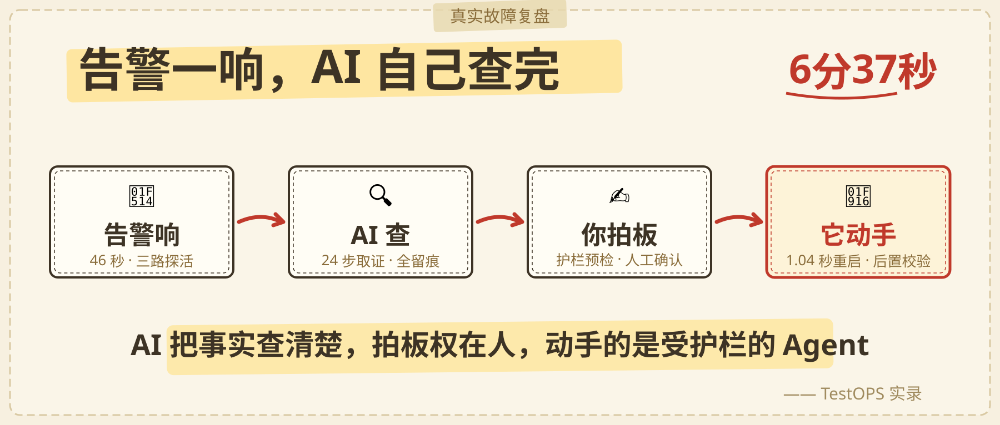
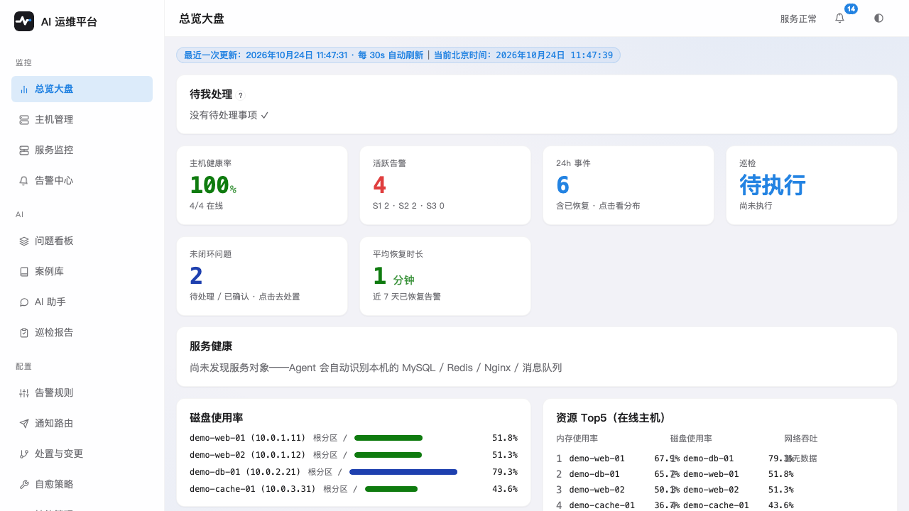
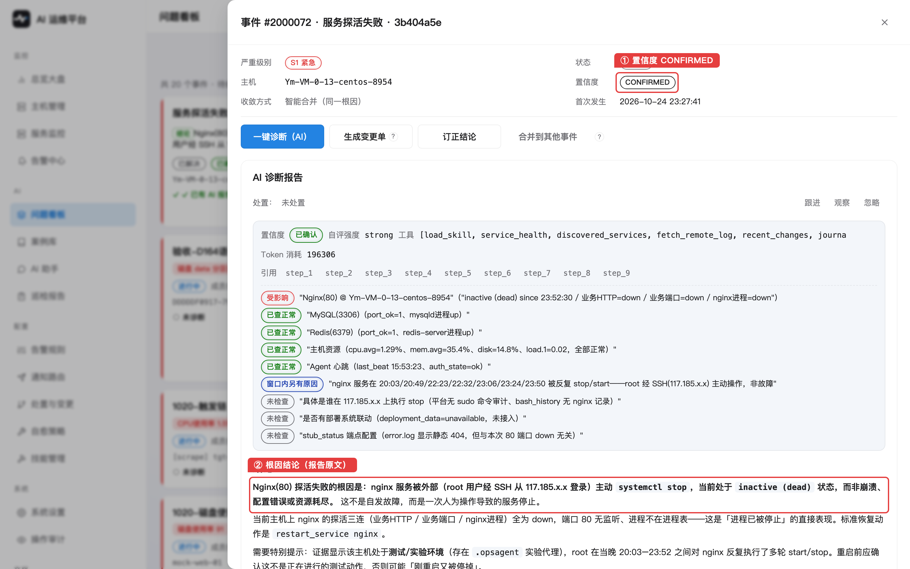
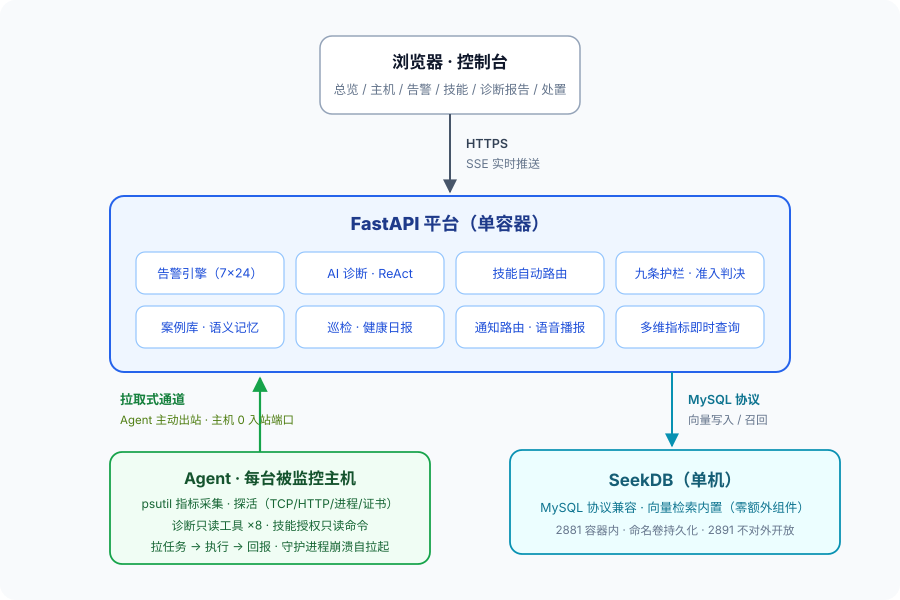
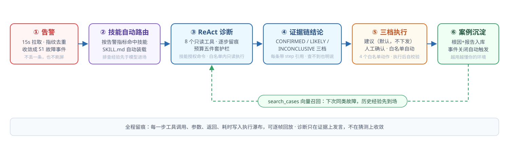

<div align="center">

# TestOPS · AI 运维监控平台

**告警响了，AI 已经查完，证据链摆在你面前。**

[English](README.en.md) | **简体中文**

开源自托管的 AI 运维监控平台：拉取式 Agent 接管主机与服务监控（被监控机零入站端口），告警收敛成事件后交给**带证据链的诊断 Agent** 自主排查取证；处置只在白名单内、经九道护栏准入后执行——**AI 负责把事实查清楚，拍板权在人**。

[](LICENSE)
[](https://www.python.org/)
[](deploy/docker-compose.yaml)
[]()



| **82 秒** | **10 分钟** | **0** |
|:---:|:---:|:---:|
| 告警刷新（三路探活） | 出带证据链的根因报告 | 入站端口（拉取式 Agent） |

*以上数字来自一次真实故障处置的实测（含 CONFIRMED 结论与全程审计记录）。*

```bash
git clone https://github.com/qsumm/TestOPS.git && cd TestOPS
cp backend/.env.example .env   # 把 JWT_SECRET / KEY_STORE_SECRET / DB_PASSWORD 换成随机值！
docker compose --env-file .env -f deploy/docker-compose.yaml up -d --build
```
> 首次构建约 3~6 分钟（pip 走阿里云镜像）；GitHub 连不上时用镜像加速 clone，见下文「5 分钟跑起来」。

</div>

---

## 为什么是它

你有没有过这种凌晨：告警响了，你 SSH 上去翻日志、看进程、猜原因，半小时后发现自己重启了一个根本没坏的服务。

这个平台把那段流程交给 AI——但**不是**让 AI 直接上生产机乱动。它的哲学写在代码里：

> 恢复能力的难点不在"执行"，而在"**敢于不执行**"。

## 核心功能



**监控** — 拉取式 Agent 接入（主机**零入站端口**，防火墙 / NAT / 安全组后零改动）· 探活四件套（进程 / TCP / HTTP / 证书临期）· 多维指标即时查询 · Prometheus 数据源 · 主机与服务健康总览

**告警** — 阈值 / 3σ / 孤立森林 · 指纹去重（同一故障合并成一个事件，不刷屏）· 静默策略链与维护窗口 · 多渠道通知（邮件 / Webhook / **电话语音播报**）· 触发即给方向判断

**AI 诊断** — ReAct 多步自主排查（每步查什么由上一步结果决定，全程留痕可逐帧回放）· **结论必须引用证据**（每条带 step 引用，可点回原始取证）· 置信度三档（**查不出也是合法结论**）· not_checked 显式标注 · 诊断技能系统（SKILL.md 插件，告警自动路由装载，只执行技能预授权的只读命令）

**处置** — 白名单仅 4 个动作（重启服务 / 重启容器 / 重连连接池 / 轮转日志）· 九道护栏准入（只读分类 → denylist → 白名单 → 限流熔断 → 发布窗口互斥 → 上游异常拒自愈 → 人工审批）· 三档执行（仅建议 / 人工确认 / 白名单自动）· 执行后**强制后置校验**，失败计熔断 · 变更单版本化与全操作审计留痕

**沉淀与评测** — 事件关闭自动沉淀向量案例卡，下次同类故障由 `search_cases` 先召回 · 定时巡检健康日报，异常自动建事件 · 诊断评测闭环：故障录制—回放、根因一致率 / 冲突率 / 校准率打分、版本指纹对比

**开放性** — 全量 REST API + MCP 接入，可嵌进你自己的工具链

## 六个核心设计

| | 设计 | 一句话 |
|---|---|---|
|  | **AI 诊断带证据链** | 最多 30 步，每步思考/工具调用/返回全留痕；结论必须引用证据——查不出也是合法结论 |
|  | **九条护栏准入判决** | 动作白名单（没有自由文本命令）、限流、熔断、发布窗口互斥、上游异常拒自愈……任何一条不过就不许动 |
|  | **拉取式通道穿透 NAT** | Agent 从主机**主动出站**拉任务，主机不开任何入站端口——防火墙后、NAT 后、云安全组零改动 |
|  | **诊断技能可插拔** | 技能就是一个 SKILL.md 文件——告警命中自动装载，Agent 只执行技能预授权的只读命令；GitHub 一键导入，命中与采用次数可查 |
|  | **案例库越用越聪明** | 每次诊断沉淀为向量案例，下次同类故障 AI 直接召回"上次怎么修的" |
|  | **5 分钟部署** | 一条 compose 命令，向量检索内置在数据库里，不额外装 Milvus/Pinecone |

## 它做什么 / 不做什么

**做**：主机与服务监控、主动告警（多渠道通知 + 电话语音播报）、AI 根因诊断（带证据链）、诊断技能自动路由（Agent 只读授权命令）、白名单内处置动作（重启/重连/轮转日志）、定时巡检、多维指标即时查询、案例沉淀。

**不做**：替代你的 Prometheus（坐在它后面）、无人值守自治（三档执行模式默认人工确认）、执行白名单外的任何命令（AI 提议 `rm -rf` 在第一层护栏就被拦下）。

## 诊断报告长什么样

每条结论带 step 引用，可点回原始取证；查不到的明确写进 not_checked——**查不出也是合法结论**：



## 架构一屏



**诊断闭环**（点对点全程留痕，每步可回放）：



## 部署

### 前置条件

| 项 | 要求 | 说明 |
|---|---|---|
| Docker + Compose | Docker 20.10+，`docker compose` v2 | `docker compose version` 能打印版本即可 |
| 内存 | 建议 ≥ 4GB | 平台 + 数据库 + 两个模拟主机同时跑；2GB 会 OOM |
| 磁盘 | 建议 ≥ 10GB | 数据库镜像 820MB + 依赖层 |
| 端口 | 8848（平台）、2891（数据库） | 被占用就改 `deploy/docker-compose.yaml` 里的 `ports` |
| 网络 | 首次构建需能访问镜像源与 pypi | 已默认走国内源，无需自备梯子 |

### 三步部署

```bash
git clone https://github.com/qsumm/TestOPS.git && cd TestOPS
cp backend/.env.example .env   # ① 复制环境变量模板
docker compose --env-file .env -f deploy/docker-compose.yaml up -d --build   # ② 构建并启动
```

③ **生成并填入三个密钥**（`.env` 里替换 `change-me-in-env` 与空的 `DB_PASSWORD`）：

```bash
python3 -c "import secrets;print(secrets.token_urlsafe(48))"   # 跑三次，分别填 JWT_SECRET / KEY_STORE_SECRET / DB_PASSWORD
```

- `JWT_SECRET` / `KEY_STORE_SECRET`：**公开部署必须换**。前者是登录令牌签名密钥，后者是你在系统设置页填的 LLM API Key 的落库加密密钥——用仓库里的默认值等于把钥匙挂在门上
- `DB_PASSWORD`：本机试玩可留空；公网或多人使用必须填

改完 `.env` 后执行 `docker compose --env-file .env -f deploy/docker-compose.yaml up -d` 让配置生效。

### 验证是否成功

```bash
curl http://127.0.0.1:8848/api/health      # 期望 {"code":0,...,"status":"up"}
docker ps                                   # 4 个容器应全为 Up / healthy
docker logs aiops-platform | grep -i "管理员"   # 首次启动生成的管理员账号会打印在这里
```

浏览器打开 `http://127.0.0.1:8848`，用日志里打印的管理员账号登录（**首登先改口令**）。此时平台在跑，但 **AI 功能还没有模型**——去「系统设置 → LLM 配置」填一个 OpenAI 兼容端点（Base URL / API Key / 模型名），保存后即可用。监控、告警、探活、巡检不依赖模型，能独立工作。

### 想立刻看到它干活

```bash
# 灌 7 天演示数据（指标 + 规则 + 历史事件 + 案例卡）
docker compose --env-file .env -f deploy/docker-compose.yaml exec platform     python scripts/seed_demo.py --days 7

# 触发一次真实故障（5 种：探活失败 / CPU / 磁盘 / 内存 / 进程假死，各一条命令，自动恢复）
bash deploy/faults/cpu_spike.sh
```

### 常见问题

| 现象 | 原因与解法 |
|---|---|
| `git clone` 超时 / `end of file` | 国内网络访问 GitHub 不稳，用镜像加速：`git clone https://gh-proxy.com/https://github.com/qsumm/TestOPS.git` |
| 构建卡在 `apt-get` | 基础镜像与 pip 源已默认走国内源；若仍卡，Dockerfile 里 `APT_MIRROR` / `PIP_INDEX_URL` 换回官方源重试 |
| 容器反复重启、报 `Restarting` | 内存不足（需 ≥4GB），或数据库首次初始化未完成；`docker logs aiops-platform` 看具体原因 |
| 登录提示「安装令牌无效」 | 首次部署的 Agent 需要一次性安装令牌：在「主机管理 → 接入新主机」生成，写进 `.env` 的 `AIOPS_INSTALL_TOKEN_1/_2`，再 `docker compose ... up -d` 重建 agent 容器 |
| AI 诊断报「未配置模型」 | 「系统设置 → LLM 配置」未填或未启用；填完再点一键诊断 |
| 端口被占用 | 改 `deploy/docker-compose.yaml` 里 `8848` / `2891` 的映射端口 |

### 数据与卸载

```bash
docker compose --env-file .env -f deploy/docker-compose.yaml down      # 停服务，保留数据
docker compose --env-file .env -f deploy/docker-compose.yaml down -v   # 连数据卷一起删（不可恢复）
```

数据在 Docker 卷 `aiops-demo_seekdb-data`（时序指标 + 事件 + 案例）；备份即导出该卷。

> 完整操作手册不在开源包内：关注公众号「一鸣AI编程」，转发文章后获取。

## 与开源同类工具对比

| # | 核心功能 | **TestOPS（本平台）** | 夜莺 Nightingale | Keep | k8sgpt | HolmesGPT |
|---|---|---|---|---|---|---|
| 1 | Agent 一体化采集（指标+探活+断网续传） | ✅ 拉取式，0 入站端口 | ✅ Categraf（推模式） | ❌ | ❌ | ❌ |
| 2 | 告警引擎（指纹去重 + 静默策略链 + 生效时段） | ✅ | ✅ 强项 | ◐ 告警聚合降噪 | ❌ | ❌ |
| 3 | 分级通知 + 电话语音播报 + 通知路由 | ✅ 含电话实测 | ◐ 渠道多 | ✅ 100+ 集成/路由强项 | ❌ | ❌ |
| 4 | 两级收敛成事件（LLM 因果判定合并） | ✅ | ◐ 屏蔽/分发 | ✅ AI 告警关联强项 | ❌ | ◐ 分析单条告警 |
| 5 | AI 根因诊断（ReAct 证据链留痕 + 技能自动路由） | ✅ | ◐ 有 AI 摘要（源码核实），根因分析经生态方案 | ◐ AI 富化/摘要 | ✅ 限 K8s 对象 | ✅ 强项 |
| 6 | 修复建议先验证（VALIDATED FIXES，没验证不建议） | ✅ | ❌ | ◐ 工作流可自编排验证 | ◐ 给建议，非内置强制 | ◐ 迭代取证后建议，非强制规范 |
| 7 | 白名单处置 + 九条护栏 + 三档执行 | ✅ 一次性审批 | ◐ 自愈执行脚本，无护栏准入层 | ◐ 工作流自动化，无护栏概念 | ◐ K8s 资源层自动修复 | ❌ |
| 8 | 案例库向量召回（"上次怎么修的"自动注入） | ✅ 内置向量检索 | ❌ | ❌ | ❌ | ◐ 商业版有历史沉淀 |
| 9 | 定时巡检 + 健康日报 + 异常自动建事件 | ✅ | ❌ | ◐ 可经工作流拼装 | ❌ | ❌ |
| 10 | 服务级监控 + 日志取证（按告警锚定时间窗回拉相关片段） | ✅ | ◐ 有日志类数据源接入 | ❌ | ❌ | ◐ 可查日志数据源 |
| 11 | K8s in-cluster 深度支持（operator / 自动修复 / 自定义 analyzer） | ❌ | ◐ 云原生集成 | ◐ | ✅ | ✅ |
| 12 | 声明式自动化工作流（YAML 任意编排告警处置） | ◐ 白名单 4 动作 + 自愈策略，无通用编排 | ◐ 脚本自愈 | ✅ 强项 | ◐ | ◐ 结构化 runbook |
| 13 | 事件管理全流程（on-call 排班 / 升级策略 / 工单联动） | ❌ | ◐ | ✅ 强项 | ❌ | ❌ |

## 安全

- 大模型 key **AES-GCM 加密落库**，接口只返回尾号
- 处置动作**白名单枚举**（4 个），每个动作强制声明后置校验
- 全 API 经过五向量攻击矩阵自测（未认证/越权/路径变异/参数变异/请求体变异），工具开源在 `tools/attack_matrix.py`
- 漏洞报告：通过 GitHub 安全通告（Security Advisories）提交。

## 🤝 贡献指南

欢迎提 Issue 和 Pull Request。这个项目最需要的不是「提个功能」，而是**把你在真机上踩到的坑修掉**——每一条真实故障、每一个误报、每一次护栏误拦，都是最有价值的贡献。

**Issue**：报 bug 请附上「环境 + 复现步骤 + 期望 vs 实际 + 相关日志」（平台日志用 `docker logs aiops-platform`，Agent 日志在目标机的 agent 输出里）；提需求先搜一下有没有重复。

**Pull Request**：

```bash
git clone https://github.com/qsumm/TestOPS.git && cd TestOPS
# 开发环境：后端 FastAPI + SQLite/SeekDB 二选一，前端免构建
./.venv/bin/python -m pytest backend/tests -q     # 全量测试必须全绿
```

几条硬性约定：

1. **前端免构建**：`static/js/pages/*.js` 是 ESM 直载，改完刷新即生效，没有打包步骤——不要引入构建链
2. **改了前端必过语法门禁**：`./.venv/bin/python -m pytest backend/tests/test_d3_frontend_assets.py -q`（一个括号错会让整个模块图加载失败、页面白屏且无报错）
3. **改了后端补测试**：新增/修复逻辑都要有对应用例，`backend/tests/` 按 `test_d<序号>_<主题>.py` 命名
4. **不要提交任何真实资产**：真实 IP、真实主机名、API Key、告警截图、内部文档一律不入库；演示数据一律用 `demo-*` 假名
5. **提交前过一遍敏感扫描**：`python tools/oss_export.py` 会检查导出包，一旦命中敏感词会直接拒绝导出——本地也请先跑一次

**安全漏洞**不要开公开 Issue，走 GitHub 安全通告（Security Advisories）私下报告。

**其他**：功能建议、文档改进、翻译、样例数据集都欢迎；在 Issue 里先聊一句能省掉很多无效 PR。

## License

[AGPL-3.0](LICENSE)。

---

<div align="center">

## 作者

**一鸣** · 公众号「**一鸣AI编程**」

*这个平台从第一行代码到 AI 诊断引擎的完整过程——每一次设计取舍、每一个踩过的坑——都在公众号里连载。*

**公众号「一鸣AI编程」**：线上故障复盘 / AI 编程实战 / 这个平台的全过程，更新不迷路。
觉得有用的话，给仓库点个 **Star ⭐**，就是最好的支持。

</div>
